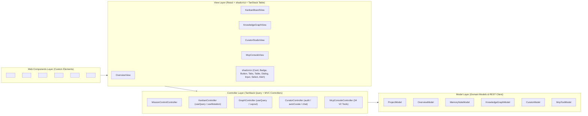

# Project Memory V2 WebUI — React + TanStack + shadcn/ui + Web Components (MVC Architecture) Implementation Plan

> **For agentic workers:** REQUIRED SUB-SKILL: Use superpowers:executing-plans to implement this plan task-by-task using strict TDD.

**Goal:** Upgrade the Project Memory V2 Mission Control WebUI to a full **MVC (Model-View-Controller)** architecture powered by **React**, **TanStack Query (`useQuery`, `useMutation`, `QueryClient`)**, **TanStack Table (`useReactTable`, `flexRender`)**, **shadcn/ui** primitives, and **W3C Custom Elements (React Web Components)**.

---

## Architecture Overview (Full-Stack & Frontend MVC)

---

## Tasks

### Task 1 (TDD): MVC Models & Controllers (`src/v2/webui/models.ts`, `src/v2/webui/controllers.ts`)
- Define strongly-typed domain Models (`ProjectModel`, `OverviewModel`, `MemoryNoteModel`, `KnowledgeGraphModel`, `CuratorModel`, `McpToolModel`) and server/client MVC Controllers (`WebUiMvcController`).
- Serve modular frontend MVC scripts at:
  - `GET /mvc/vendor.js` (React VDOM/Hooks runtime + `@tanstack/react-query` + `@tanstack/react-table`)
  - `GET /mvc/models.js` (Client MVC Models & Query Keys)
  - `GET /mvc/controllers.js` (Client MVC Controllers using `useQuery`, `useMutation`, `useReactTable`)
  - `GET /mvc/shadcn-ui.js` (shadcn/ui components & HSL theme tokens)
  - `GET /mvc/views.js` (React MVC Views)
  - `GET /mvc/web-components.js` (Custom Elements `<pm-mission-control>`, `<pm-overview-panel>`, `<pm-kanban-board>`, `<pm-knowledge-graph>`, `<pm-curator-studio>`, `<pm-mcp-console>`, `<pm-stat-card>`)

### Task 2 (TDD): Verify React + TanStack + shadcn/ui + Web Components MVC Endpoints & Rendering
- Extend `tests/v2-webui-and-curator.test.ts` to assert:
  - `GET /` renders the shadcn/ui dark theme variables, MVC script tags, and Custom Element tags (`<pm-mission-control>`, etc.).
  - `GET /mvc/vendor.js` exports React hooks (`useState`, `useEffect`, `useMemo`), TanStack Query (`QueryClient`, `useQuery`, `useMutation`), and TanStack Table (`useReactTable`, `flexRender`).
  - `GET /mvc/models.js`, `GET /mvc/controllers.js`, `GET /mvc/shadcn-ui.js`, `GET /mvc/views.js`, and `GET /mvc/web-components.js` return `200 OK` with `application/javascript` and contain their respective MVC classes/components/Custom Elements (`customElements.define`).
  - Server-side `WebUiMvcController` cleanly orchestrates `ProjectModel`, `MemoryNoteModel`, `KnowledgeGraphModel`, and `CuratorModel`.

### Task 3: Production Build, Multi-Project Sync, Live Browser Verification & V2 Session End
- Run `scripts/build.js`, restore `dist/index.js` shim, sync all 4 local projects, launch the live server at `http://127.0.0.1:4321`, and close the V2 session with an ADR.
