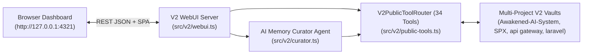

# Project Memory V2 WebUI & AI Memory Curator Agent — Design Spec

**Date:** 2026-10-21  
**Project:** `Awakened-AI-System` (Project Memory V2)  
**Scope:** Multi-Project Memory Mission Control WebUI (`src/v2/webui.ts`), Autonomous & Conversational AI Memory Curator Agent (`src/v2/curator.ts`), and V2 Admin CLI integration (`src/v2/admin.ts`).

---

## 1. Problem Statement & Goals

Project Memory V2 now powers multi-project governed memory (`Awakened-AI-System`, `SPX`, `api gateway`, `laravel`) with 34 MCP tools, cryptographic event logs, SQLite v3 projections, Thai/English hybrid retrieval, and file/symbol graphs. However, inspecting and governing memories across multiple projects currently requires CLI commands or raw MCP calls.

We need a **WebUI + AI Memory Curator Agent** that:
1. Lets users and AI agents visually inspect, search, and govern memories (`candidate` $\rightarrow$ `approved`, `supersede`, `retract`, `expire`) across all local projects in one dashboard.
2. Visualizes the **File-Path & Code-Symbol Knowledge Graph** connecting code artifacts to ADRs, Insights, and Mistakes.
3. Provides an **AI Memory Curator Agent** capable of:
   - **Autonomous Vault Auditing**: Detecting duplicate clusters, stale notes, unpromoted candidates with evidence, and follow-up radar risks, producing a quantitative health score and actionable 1-click fixes.
   - **1-Click Auto-Curation**: Automatically promoting verified candidates, superseding duplicate notes, and expiring stale memories inside a governed V2 session (`memory_sessionStart` $\rightarrow$ governed actions $\rightarrow$ `memory_sessionEnd`).
   - **Bilingual (Thai + English) AI Copilot Chat**: Understanding natural language instructions (e.g., *"วิเคราะห์สุขภาพความจำ"*, *"หาความจำซ้ำ"*, *"อนุมัติ candidate ทั้งหมด"*, *"สรุปความจำโปรเจคนี้"*, *"ค้นหา ..."*) and executing the corresponding V2 tools, with optional external LLM API integration (`MEMORY_V2_CURATOR_LLM_URL`).
4. Preserves 100% compatibility with V2's strict build integrity gates (`scripts/build.js` and `scripts/fresh-start-build.js`) by using only Node.js built-in modules (`node:http`, `node:fs`, `node:path`, `node:url`, `node:crypto`).

---

## 2. Architecture

### Component Breakdown
1. **`src/v2/curator.ts` (`V2MemoryCuratorAgent`)**:
   - Consumes a `V2PublicToolRouter` instance.
   - `auditVault(options?)`: Calls `memory_awaken`, `memory_followUpRadar`, `memory_findDuplicates`, `memory_checkStaleness`, `memory_lifecycleStatus`, and `memory_list` to produce a `CuratorAuditReport` (`healthScore`, `counts`, `duplicateGroups`, `staleNotes`, `candidateQueue`, `recommendations`).
   - `autoCurate(options?)`: Starts a governed curator session (`memory_sessionStart`), promotes qualifying `candidate` notes (`memory_promote`), supersedes redundant duplicates (`memory_supersede`), expires stale notes (`memory_expire`), and closes the session (`memory_sessionEnd`), returning a `CuratorExecutionReceipt`.
   - `chat(input)`: Bilingual Thai/English intent engine + optional LLM endpoint bridge that maps user requests to V2 MCP tool calls and returns a structured assistant response with `reply`, `intent`, `executedTools`, and `data`.
2. **`src/v2/webui.ts` (`createV2WebUiHandler`, `startV2WebUiServer`)**:
   - Multi-project router manager caching or instantiating `V2Foundation` + `V2PublicToolRouter` + `V2MemoryCuratorAgent` per `projectRoot`.
   - Exposes JSON REST endpoints:
     - `GET /api/projects` & `POST /api/projects/bootstrap`
     - `GET /api/overview`
     - `GET /api/notes` & `GET /api/notes/:noteId`
     - `POST /api/governance` (`promote`, `supersede`, `retract`, `expire`, `writeADR`, `writeInsight`, `writeMistake`)
     - `GET /api/graph` (File-Path $\leftrightarrow$ Code-Symbol $\leftrightarrow$ Note Knowledge Graph)
     - `GET /api/curator/audit`, `POST /api/curator/auto-curate`, `POST /api/curator/chat`
     - `POST /api/mcp/call` (Direct 34-tool MCP console)
   - Serves the self-contained Thai/English Mission Control SPA at `GET /`.
3. **`src/v2/admin.ts` (`webui` command)**:
   - Supports `node dist/v2-admin.js webui --project-root <path> [--port 4321] [--host 127.0.0.1]`.
   - Added as `npm run webui` in `package.json`.
